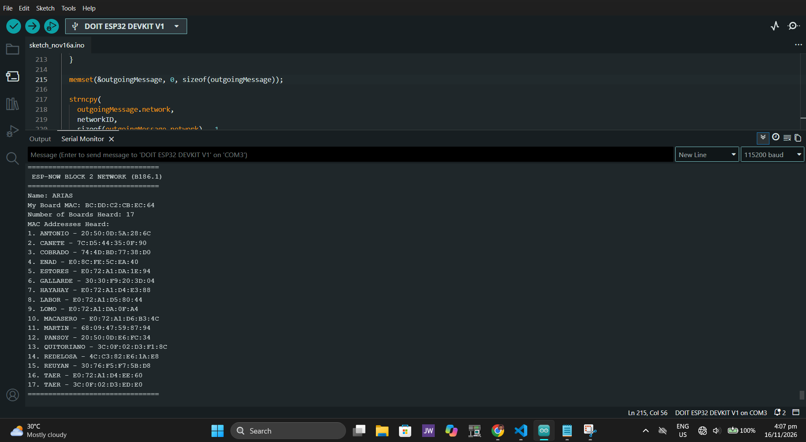

# BCA188 - Laboratory Activity 10
## ESP-NOW Block Network

### Student Information

| Field | Details |
|---|---|
| Name | arias_bertalde |
| Block | B186.1 - Block 2 |
| Board | DOIT ESP32 DEVKIT V1 |
| MAC Address | BC:DD:C2:CB:EC:64 |
| Boards Heard | 17 |
| Date | November 16, 2026 |
| Time | 4:07 PM (PHT) |

## ESP-NOW Network Results

The ESP32 successfully communicated with other ESP32 boards using the ESP-NOW wireless communication protocol.

A total of **17 unique boards** were detected during the block network activity.

### MAC Addresses Heard

| No. | Last Name | MAC Address |
|---|---|---|
| 1 | ANTONIO | 20:50:0D:5A:28:6C |
| 2 | CANETE | 7C:D5:44:35:0F:90 |
| 3 | COBRADO | 74:4D:BD:77:38:D0 |
| 4 | ENAD | E0:8C:FE:5C:EA:40 |
| 5 | ESTORES | E0:72:A1:DA:1E:94 |
| 6 | GALLARDE | 30:30:F9:20:3D:04 |
| 7 | HAYAHAY | E0:72:A1:D4:E3:88 |
| 8 | LABOR | E0:72:A1:D5:80:44 |
| 9 | LOMO | E0:72:A1:DA:0F:A4 |
| 10 | MACASERO | E0:72:A1:D6:B3:4C |
| 11 | MARTIN | 68:09:47:59:87:94 |
| 12 | PANSOY | 20:50:0D:E6:FC:34 |
| 13 | QUITORIANO | 3C:0F:02:D3:F1:8C |
| 14 | REDELOSA | 4C:C3:82:E6:1A:E8 |
| 15 | REUYAN | 30:76:F5:F7:5B:D8 |
| 16 | TAER | E0:72:A1:D4:EE:60 |
| 17 | TAER | 3C:0F:02:D3:ED:E0 |

## Serial Monitor Output

The ESP32 was monitored using the Arduino IDE Serial Monitor at **115200 baud**.

The output displayed:
- Student's last name
- ESP32 MAC address
- Total number of boards heard
- MAC addresses of detected boards
- Alphabetically sorted student last names

## Evidence

