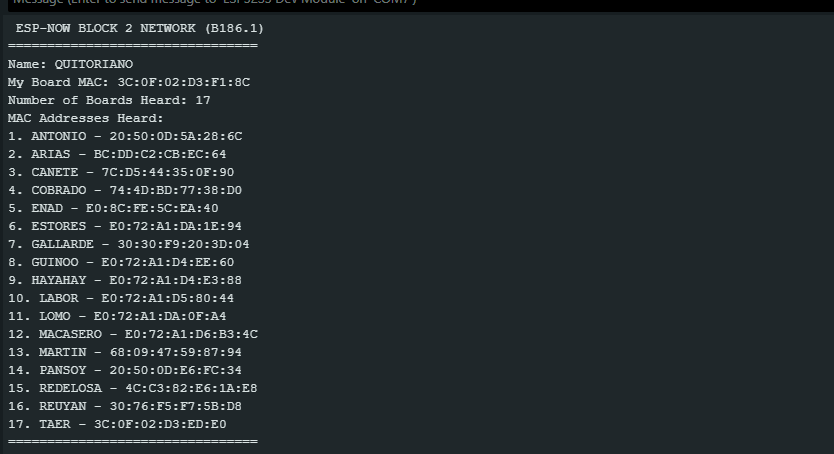

# BCA188 - Laboratory Activity 10: ESP-NOW Block 2 Network

## Lab Results

* **Name:** [QUITORIANO_VINCENTADRIAN]
* **My Board's MAC Address:** `[3C:0F:02:D3:F1:8C]`
* **Number of Boards Heard:** [17]
* **Date and Time of Window:** [November 16, 2026 | 15:00 PM - 18:000 PM]

## MAC Addresses Heard

1. `20:50:0D:5A:28:6C` - ANTONIO
2. `BC:DD:C2:CB:EC:64` - ARIAS
3. `7C:D5:44:35:0F:90` - CANETE
4. `74:4D:BD:77:38:D0` - COBRADO
5. `E0:8C:FE:5C:EA:40` - ENAD
6. `E0:72:A1:DA:1E:94` - ESTORES
7. `30:30:F9:20:3D:04` - GALLARDE
8. `E0:72:A1:D4:EE:60` - GUINOO
9. `E0:72:A1:D4:E3:88` - HAYAHAY
10. `E0:72:A1:D5:80:44` - LABOR
11. `E0:72:A1:DA:0F:A4` - LOMO
12. `E0:72:A1:D6:B3:4C` - MACASERO
13. `68:09:47:59:87:94` - MARTIN
14. `20:50:0D:E6:FC:34` - PANSOY
15. `4C:C3:82:E6:1A:E8` - REDELOSA
16. `30:76:F5:F7:5B:D8` - REUYAN
17. `3C:0F:02:D3:ED:E0` - TAER

## Evidence Attached

### Serial Monitor Screenshot

### 30-Second Screen Recording
[Watch 30-Second Screen Recording](./screen_record.mp4)